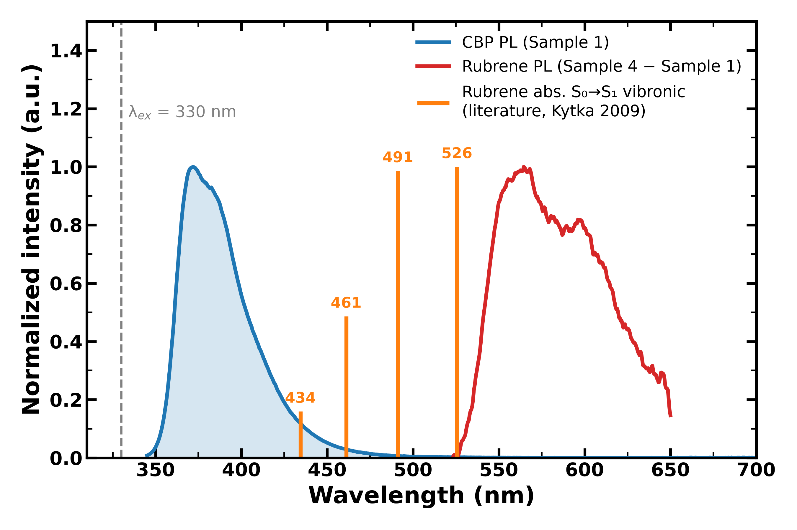
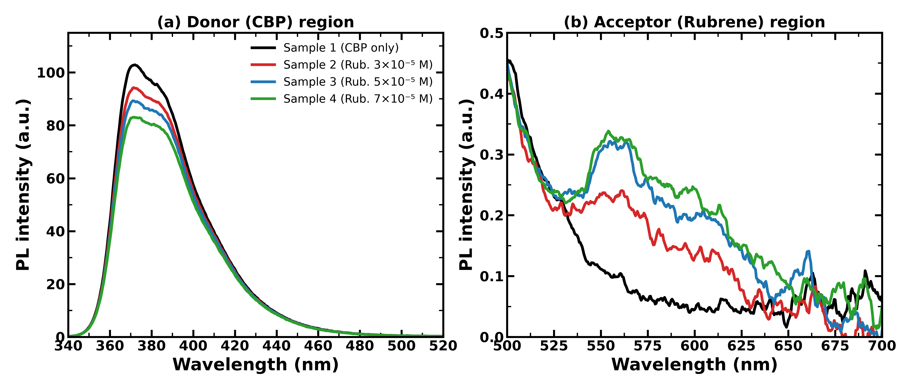
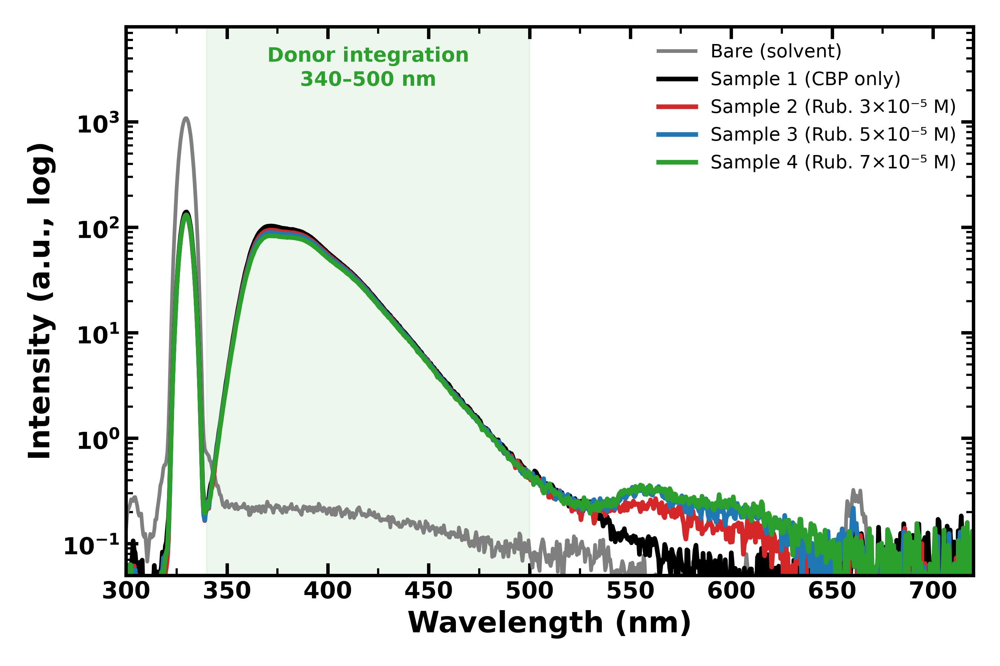
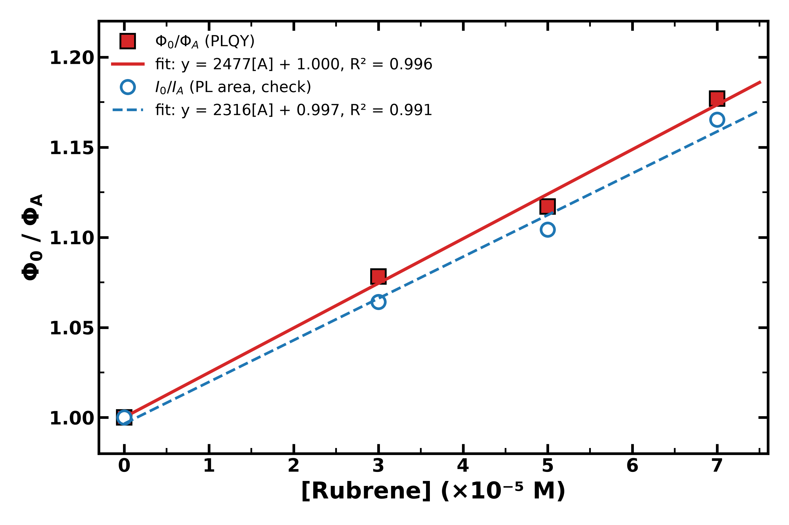

# OLED 실험 8주차 — Energy Transfer와 Stern-Volmer 분석

**작성자:** 이영빈 **학번:** 2023101942

> Donor: **CBP** (5 × 10−4 M 고정) / Acceptor: **Rubrene** (0, 3, 5, 7 × 10−5 M) / 용매: **1,2-dichlorobenzene** 
> 측정: 적분구 PL 및 PLQY (JASCO FP-8300, ILF-835 적분구, λex = 330 nm, 300–780 nm, 0.5 nm 간격)

---

## Ⅰ. 실험 목적

- OLED 발광층의 host → dopant 에너지 전달 원리(FRET, Dexter)를 이해한다.
- Acceptor 농도에 따른 donor의 PLQY 변화를 Stern-Volmer 식에 적용하여 energy transfer rate를 구한다.
- 구한 energy transfer rate를 용매의 확산속도상수와 비교하여 에너지 전달 메커니즘을 해석한다.

---

## Ⅱ. 실험 원리

### A. 에너지 전달과 spectral overlap

OLED 발광층은 보통 빛을 직접 내지 않는 host와 빛을 내는 dopant로 이루어진다. Host에서 만들어진 exciton이 dopant로 넘어가야 dopant의 발광을 얻을 수 있으므로, 두 물질 사이의 에너지 전달 효율이 소자 효율을 좌우한다. 에너지는 높은 상태에서 낮은 상태로 흐르므로 host(donor)의 들뜬 에너지가 dopant(acceptor)보다 커야 한다.

에너지 전달이 잘 일어나려면 donor의 발광 스펙트럼 ID(λ)와 acceptor의 흡수 스펙트럼 εA(λ)가 많이 겹쳐야 한다. 겹친 정도는 spectral overlap integral J로 나타낸다.

> J(λ) = ∫0∞ ID(λ) · εA(λ) · λ4 dλ

### B. FRET와 Dexter energy transfer

**Förster resonance energy transfer (FRET)** 는 들뜬 donor와 바닥상태 acceptor의 전이 쌍극자가 Coulomb 상호작용(dipole–dipole)으로 결합하여 에너지를 넘기는 과정이다. 전자가 직접 오가지 않으므로 두 분자가 닿을 필요가 없고, 약 1–10 nm 거리에서 일어난다. 전달 확률이 50 %가 되는 거리를 Förster distance R0라 하며 속도상수는 거리의 6제곱에 반비례한다.

> R06 = 0.2108 · κ2 · φD · n−4 · J(λ) 
> kFörster = (1/τD) · (R0/R)6

φD는 donor의 형광 양자효율, n은 굴절률, κ2는 쌍극자 방향 인자(무작위 배향에서 2/3), τD는 donor의 형광 수명, R은 donor–acceptor 거리이다.

**Dexter energy transfer** 는 두 분자의 전자구름이 겹칠 만큼 가까워졌을 때 전자를 서로 교환하여 에너지를 넘기는 과정이다. 그래서 스펙트럼 겹침 외에 궤도 겹침이 필요하고, 거리가 늘면 지수적으로 감소하는 단거리(약 1 nm 이하) 과정이다.

> kDexter = K · J · exp(−2RDA/L)

J는 정규화된 overlap integral, RDA는 donor–acceptor 거리, L은 두 분자의 van der Waals 반지름 합, K는 실험 상수이다. FRET는 스핀 보존 규칙 때문에 singlet–singlet 전달만 가능하지만, Dexter 전달은 전자 교환으로 일어나므로 triplet–triplet 전달도 가능하다.

### C. Stern-Volmer 관계

Donor D와 acceptor A가 함께 있는 용액에서 일어나는 과정과 속도는 다음과 같다.

| 과정 | 반응 | 속도 |
|------|------|------|
| 흡수 | D + hν → D* | Ia |
| 발광 | D* → D + hν | k1[D*] |
| 에너지 전달(quenching) | D* + A → D + A* | k2[D*][A] |
| 비발광 소멸 | D* → D + heat | k3[D*] |

정상상태에서 donor의 발광 양자효율은 D*가 사라지는 전체 경로 중 발광 경로의 비율이다.

> Φ0 = k1 / (k1 + k3)  (acceptor 없음) 
> ΦA = k1 / (k1 + k3 + k2[A])  (acceptor 있음)

두 식을 나누고 acceptor가 없을 때의 형광 수명 τ = 1/(k1 + k3)을 대입하면 Stern-Volmer 식을 얻는다.

> Φ0/ΦA = 1 + k2[A] / (k1 + k3) = 1 + k2τ[A] = 1 + KSV[A]

따라서 [A]에 대한 Φ0/ΦA 그래프의 기울기 KSV를 τ로 나누면 energy transfer rate k2를 구할 수 있다.

### D. Quantum yield와 적분구 측정

Quantum yield는 흡수한 광자 수에 대해 방출된 광자 수의 비율이다. 적분구는 내부가 고반사 물질로 코팅되어 있어 시료에서 모든 방향으로 나온 빛을 모아 검출하므로 절대 양자효율을 측정할 수 있다. 용매만 담은 blank에서 들어온 여기광 세기를 얻고, 시료를 넣었을 때 줄어든 여기광 세기(흡수된 광자 수)와 새로 생긴 발광 세기(방출된 광자 수)를 비교하여 PLQY를 계산한다.

### E. 확산속도상수

용액에서 두 분자가 충돌해야 일어나는 반응은 분자가 확산으로 만나는 속도보다 빠를 수 없다. 이 상한을 확산속도상수 kdiff라 한다. Smoluchowski 식에 Stokes-Einstein 확산계수를 넣고 두 분자의 반지름이 비슷하다고 두면 다음과 같다.

> kdiff = 8RT / (3η)

R은 기체상수, T는 절대온도, η는 용매의 점도이다. 충돌이 필요한 Dexter 전달은 kdiff에 의해 속도가 제한되고, 먼 거리에서 일어나는 FRET는 kdiff보다 큰 겉보기 속도상수를 보일 수 있다.

---

## Ⅲ. 실험 방법

### A. 기구 및 재료

| 구분 | 항목 |
|------|------|
| 측정 장비 | PL spectrometer (JASCO FP-8300) + 적분구 (ILF-835), UV/Vis spectrophotometer |
| 기구 | 전자저울, 피펫, 마이크로 피펫, vial, quartz cell |
| 시료 | Donor **CBP** (4,4′-bis(N-carbazolyl)-1,1′-biphenyl, 484.59 g/mol), Acceptor **Rubrene** (532.68 g/mol), 용매 **1,2-dichlorobenzene** |

매뉴얼의 재료 목록에는 Perylene, C545T, chlorobenzene이 적혀 있지만, 이번 실험은 실제로 사용한 CBP, Rubrene, 1,2-dichlorobenzene을 기준으로 정리하였다. 결과 슬라이드 표의 "Ir Working"과 "CBP Only, Sample 1–3"은 각각 Rubrene working solution과 Sample 1–4를 뜻한다.

### B. 실험 과정

1. 1,2-dichlorobenzene을 용매로 CBP 1.0 × 10−3 M 10 mL와 Rubrene 1.0 × 10−3 M 10 mL 표준용액을 만든다.
2. Rubrene 표준용액을 1/5로 희석하여 2.0 × 10−4 M working solution을 만든다.
3. CBP 농도를 5 × 10−4 M로 고정하고 Rubrene 농도가 0, 3, 5, 7 × 10−5 M인 Sample 1–4를 각각 5 mL씩 만든다.
4. 흡수 스펙트럼으로 CBP는 흡수하고 Rubrene은 거의 흡수하지 않는 여기 파장을 정한다(λex = 330 nm).
5. 용매만 담은 quartz cell을 적분구에 넣고 같은 조건에서 blank(bare)를 측정한다.
6. Sample 1–4의 스펙트럼을 같은 조건에서 측정하고, Quantum Yield Analysis Tool에서 Rubrene 발광과 겹치지 않는 donor 영역을 적분 구간으로 정해 PLQY를 얻는다.

---

## Ⅳ. 실험 결과 및 고찰

### 1. 시료 제작에 필요한 각 solution의 양을 계산하시오.

**표준용액.** 10 mL에 1.0 × 10−3 M를 만들려면 1.0 × 10−5 mol이 필요하다.

> CBP: 1.0 × 10−3 mol/L × 0.010 L × 484.59 g/mol = 4.85 mg 
> Rubrene: 1.0 × 10−3 mol/L × 0.010 L × 532.68 g/mol = 5.33 mg

**Rubrene working solution.** 1/5 희석이므로 C1V1 = C2V2에서 다음과 같다.

> Vstock = (2.0 × 10−4 M × 10 mL) / (1.0 × 10−3 M) = 2.0 mL 
> → Rubrene 표준용액 2.0 mL + 용매 8.0 mL = 10 mL (2.0 × 10−4 M)

**혼합 시료(최종 5 mL).** 같은 식을 각 성분에 적용한다.

> VCBP = (5 × 10−4 M × 5 mL) / (1 × 10−3 M) = 2.50 mL  (모든 시료 공통) 
> VRub = ([A] × 5 mL) / (2 × 10−4 M) 
> &emsp;Sample 2: (3 × 10−5 × 5) / (2 × 10−4) = 0.75 mL 
> &emsp;Sample 3: (5 × 10−5 × 5) / (2 × 10−4) = 1.25 mL 
> &emsp;Sample 4: (7 × 10−5 × 5) / (2 × 10−4) = 1.75 mL 
> Vsolvent = 5 mL − VCBP − VRub

**Table 1 — 시료별 solution 부피 (최종 부피 5 mL)**

| 시료 | CBP Stock 1 mM | Rubrene Working 0.2 mM | Solvent | 최종 CBP 농도 | 최종 Rubrene 농도 |
|------|------|------|------|------|------|
| Sample 1 (CBP only) | 2.50 mL | 0 mL | 2.50 mL | 5 × 10−4 M | 0 |
| Sample 2 | 2.50 mL | 0.75 mL | 1.75 mL | 5 × 10−4 M | 3 × 10−5 M |
| Sample 3 | 2.50 mL | 1.25 mL | 1.25 mL | 5 × 10−4 M | 5 × 10−5 M |
| Sample 4 | 2.50 mL | 1.75 mL | 0.75 mL | 5 × 10−4 M | 7 × 10−5 M |

**검산.** Sample 4의 Rubrene 몰수는 0.2 mM × 1.75 mL = 3.5 × 10−7 mol이고, 이를 5 mL로 나누면 7.0 × 10−5 M이다. CBP는 1 mM × 2.5 mL / 5 mL = 5.0 × 10−4 M이다.

### 2. Donor, acceptor의 UV & PL 스펙트럼을 측정하여 spectral overlap을 확인하고 acceptor의 비율에 따라 변화된 PL 스펙트럼을 통해 energy transfer를 확인하시오.

**Spectral overlap.** CBP(donor)의 PL은 Sample 1 스펙트럼을, Rubrene(acceptor)의 PL은 Sample 4에서 Sample 1을 뺀 차이 스펙트럼을 사용하였다. Rubrene의 흡수는 문헌의 용액 흡수 스펙트럼 분석값(Kytka et al., 2009: S0 → S1 0–0 전이 2.359 eV, 진동 에너지 0.165 eV, Huang-Rhys 인자 0.986)으로 진동 progression의 위치와 상대 세기를 계산해 막대로 표시하였다.

> λn = 1239.84 / (2.359 + n × 0.165) eV → 526, 491, 461, 434 nm (n = 0, 1, 2, 3) 
> 상대 세기 ∝ e−S Sn / n! → 0.37, 0.37, 0.18, 0.06

**Fig. 1 — CBP PL, Rubrene PL, Rubrene S0 → S1 흡수 진동 progression(문헌값 기반)**

CBP의 PL은 372 nm에서 최대이고 384 nm 부근에 진동 shoulder를 보이며 450 nm 부근까지 꼬리가 이어진다. Rubrene의 S0 → S1 흡수대는 434–526 nm에 있으므로, CBP 발광의 장파장 꼬리가 Rubrene 흡수대의 단파장 쪽(434, 461 nm 성분)과 겹친다. 정규화한 CBP PL 세기는 434 nm에서 0.12, 461 nm에서 0.03이고, 434 nm 이후 영역은 CBP 전체 발광 면적의 약 4.7 %이다. 따라서 겹침은 존재하지만 크지 않다. 반면 Rubrene의 발광(약 565 nm 최대)은 CBP 발광과 거의 겹치지 않으므로, 두 발광을 파장으로 분리해 donor의 변화만 볼 수 있다. 또한 CBP 발광 최대의 에너지(1240/372 nm = 3.33 eV)가 Rubrene의 S1(2.36 eV)보다 높아 CBP → Rubrene 방향의 전달이 에너지적으로 가능하다.

**Acceptor 농도에 따른 PL 변화.**

**Fig. 2 — Rubrene 농도에 따른 PL 스펙트럼: (a) donor(CBP) 영역, (b) acceptor(Rubrene) 영역 ((b)는 9점 이동평균)**

**Table 2 — 시료별 PL 특성 (λex = 330 nm)**

| 시료 | [Rubrene] | CBP 최대 파장 | CBP 최대 세기 | CBP 영역 면적 (340–500 nm) | Rubrene 영역 면적 (520–700 nm) |
|------|------|------|------|------|------|
| Sample 1 | 0 | 372.0 nm | 102.9 | 4904 | 14.4 |
| Sample 2 | 3 × 10−5 M | 371.5 nm | 94.2 | 4608 | 21.2 |
| Sample 3 | 5 × 10−5 M | 371.0 nm | 89.3 | 4441 | 29.3 |
| Sample 4 | 7 × 10−5 M | 372.0 nm | 83.0 | 4208 | 32.6 |

Rubrene 농도가 0에서 7 × 10−5 M로 늘수록 CBP 발광의 최대 세기는 102.9에서 83.0으로 19 % 줄고, 면적은 4904에서 4208로 14 % 줄었다. 최대 파장과 스펙트럼 모양은 그대로이므로 CBP의 발광 상태 자체는 바뀌지 않았고 발광 세기만 줄었다. 같은 시료에서 550–600 nm의 Rubrene 발광이 새로 나타나 농도와 함께 커졌다(Rubrene 영역 면적 14.4 → 32.6). Sample 1의 이 영역 값은 CBP 발광 꼬리와 잡음에 해당한다.

여기 파장 330 nm에서는 주로 CBP가 빛을 흡수한다. 따라서 CBP 발광이 줄어드는 만큼 Rubrene 발광이 늘어나는 것은 CBP의 들뜬 에너지가 Rubrene으로 넘어가 Rubrene이 발광한 결과로 해석할 수 있고, 이는 CBP → Rubrene energy transfer가 일어났음을 보여준다. 다만 Rubrene 발광의 증가분(약 18)은 CBP 발광의 감소분(약 696)보다 훨씬 작다. 이는 CBP에서 사라진 에너지가 모두 Rubrene 발광으로 나오지는 않았다는 뜻이며, 문항 4에서 다시 다룬다.

### 3. Stern-Volmer equation에 따라 acceptor의 PL 영역과 겹치지 않는 donor의 PL 영역을 적분 구간으로 설정하여 donor만 있을 때의 PLQY와 donor에 acceptor의 비율에 따라 변화된 PLQY 값을 확인하여 Φ0/ΦA를 구한 뒤 이를 이용하여 Energy transfer rate를 추론하시오. (단, 형광의 lifetime은 10 ns로 가정한다.)

**적분 구간.** Rubrene 발광은 약 520 nm부터 시작하므로, Rubrene 발광과 겹치지 않도록 산란 peak(330 nm) 이후부터 500 nm까지를 donor 적분 구간으로 사용하였다(Quantum Yield Analysis Tool에서 설정한 구간도 약 340–500 nm).

**Fig. 3 — 적분구에서 측정한 blank와 Sample 1–4의 스펙트럼 (로그 축, 녹색: donor 적분 구간)**

330 nm의 산란 peak가 blank(1084)보다 시료(127–140)에서 크게 작은 것은 시료가 여기광의 대부분을 흡수했다는 뜻이다(흡수율 87–88 %). 장비가 계산한 PLQY(Int. Quantum Efficiency)를 Φ로 사용하였다.

> Φ0/ΦA = Φ(Sample 1) / Φ(Sample n) 
> &emsp;Sample 2: 79.617 / 73.841 = 1.078 
> &emsp;Sample 3: 79.617 / 71.274 = 1.117 
> &emsp;Sample 4: 79.617 / 67.651 = 1.177

**Table 3 — 시료별 PLQY와 Φ0/ΦA**

| 시료 | [A] (M) | 흡수율 (%) | PLQY Φ (%) | Φ0/ΦA |
|------|------|------|------|------|
| Sample 1 | 0 | 87.027 | 79.617 | 1.000 |
| Sample 2 | 3 × 10−5 | 88.178 | 73.841 | 1.078 |
| Sample 3 | 5 × 10−5 | 88.036 | 71.274 | 1.117 |
| Sample 4 | 7 × 10−5 | 87.892 | 67.651 | 1.177 |

**Fig. 4 — Stern-Volmer plot (■: PLQY 비, ○: PL 면적 비 검산)**

네 점을 선형 회귀하면 다음과 같다.

> Φ0/ΦA = 2477 [A] + 1.000  (R2 = 0.996)

절편이 1.000으로 Stern-Volmer 식의 이론 절편 1과 일치하고 직선성도 좋다. 기울기가 KSV = k2τ이므로 τ = 10 ns를 대입한다.

> KSV = k2τ = 2.48 × 103 M−1 
> k2 = KSV / τ = (2.48 × 103 M−1) / (10 × 10−9 s) = **2.48 × 1011 M−1 s−1**

**검산.** 각 시료에서 k2 = (Φ0/ΦA − 1) / (τ[A])를 따로 계산하면 Sample 2–4에서 각각 2.61, 2.34, 2.53 × 1011 M−1 s−1로 회귀값과 ±6 % 안에서 일치한다. 또 raw data의 340–500 nm 면적 비(I0/IA = 1.064, 1.104, 1.165)로 같은 계산을 하면 기울기 2316 M−1(R2 = 0.991), k2 = 2.32 × 1011 M−1 s−1로 PLQY 기준 값과 7 % 차이이다. 면적 비는 흡수율 변화를 보정하지 않은 값이므로, 흡수율로 나눈 PLQY 비보다 조금 작게 나온다.

### 4. 도출한 Energy Transfer rate와 용매(1,2-dichlorobenzene)의 확산속도상수 문헌값을 비교 및 분석하시오.

**확산속도상수.** 1,2-dichlorobenzene의 25 °C 점도는 1.32 cP(= 1.32 × 10−3 Pa·s)이다.

> kdiff = 8RT / (3η) = (8 × 8.314 J mol−1 K−1 × 298.15 K) / (3 × 1.32 × 10−3 Pa·s) 
> &emsp;&emsp;= 5.01 × 106 m3 mol−1 s−1 = **5.01 × 109 M−1 s−1**  (1 m3 = 103 L)

**Table 4 — Energy transfer rate와 확산속도상수 비교**

| 항목 | 값 (M−1 s−1) | 비고 |
|------|------|------|
| k2 (실험, PLQY 기준) | 2.48 × 1011 | Stern-Volmer 기울기 / 10 ns |
| k2 (검산, PL 면적 기준) | 2.32 × 1011 | 흡수율 보정 없음 |
| kdiff (1,2-dichlorobenzene, 25 °C) | 5.01 × 109 | η = 1.32 cP 문헌값으로 계산 |
| k2 / kdiff | 49.5 | 오차율 4846 % |

**분석.** 실험으로 구한 k2는 kdiff보다 약 50배 크다. 두 분자가 확산으로 만나 충돌해야 하는 과정은 kdiff보다 빠를 수 없으므로, 충돌이 필요한 Dexter 전달만으로는 이 값을 설명할 수 없다. 따라서 CBP → Rubrene 전달에는 분자가 만나기 전 먼 거리에서 작용하는 FRET가 기여했다고 볼 수 있다. CBP와 Rubrene은 모두 singlet 들뜬상태 사이의 전달이고, 문항 2에서 CBP 발광과 Rubrene S0 → S1 흡수대의 겹침을 확인했으므로 FRET 조건을 만족한다. FRET가 작용하면 donor가 acceptor와 접촉하기 전에 에너지를 넘길 수 있어, 겉보기 속도상수가 확산 한계를 넘을 수 있다.

그러나 FRET만으로 50배 차이를 모두 설명하기는 어렵다. Rubrene 농도로 계산한 acceptor 사이 평균 반거리는 3, 5, 7 × 10−5 M에서 각각 23.6, 19.9, 17.8 nm로 FRET 거리(1–10 nm)보다 길고, 문항 2에서 본 것처럼 스펙트럼 겹침도 CBP 발광 면적의 수 % 수준으로 작다. 겉보기 k2를 키운 다른 요인은 다음과 같다.

- **형광 수명 가정.** k2 = KSV/τ이므로 k2는 τ에 반비례한다. τ = 10 ns는 가정값이며, CBP의 실제 수명이 이와 다르면 k2도 같은 비율로 달라진다. 다만 k2가 kdiff와 같아지려면 τ가 약 500 ns여야 하는데, 이는 singlet 형광 수명으로 보기 어려워 τ만으로는 차이를 설명할 수 없다.
- **Rubrene의 여기광 직접 흡수(경쟁 흡수).** Rubrene을 넣은 Sample 2의 흡수율(88.178 %)이 Sample 1(87.027 %)보다 높다. Rubrene이 직접 흡수한 330 nm 광자는 CBP 발광을 만들지 않지만, PLQY 계산에서는 흡수한 광자 수에 포함되므로 donor 영역 PLQY가 낮게 계산된다. 흡수율로 보정하지 않은 면적 비의 k2(2.32 × 1011)가 PLQY 기준 값보다 작은 것이 이 영향을 보여준다. 또 Rubrene이 직접 들떠서 낸 발광이 Fig. 2(b)의 Rubrene 발광에 일부 섞였을 수 있다.
- **재흡수(radiative transfer).** CBP가 낸 430–500 nm 빛 일부를 Rubrene이 다시 흡수하고 donor 적분 구간 밖(약 565 nm)에서 내보낼 수 있다. 적분구에서는 빛이 벽에서 여러 번 반사되어 시료를 다시 지나므로 이 효과가 커진다. 이는 분자 간 에너지 전달이 아니지만 donor PLQY를 낮추어 k2를 크게 만든다.
- **에너지 손실 경로.** CBP 발광 감소분(면적 약 696)에 비해 Rubrene 발광 증가분(약 18)이 매우 작다. 측정 감도의 파장 의존성을 고려해도, CBP에서 사라진 에너지 중 상당 부분이 Rubrene 발광으로 나오지 않았다. 용존 산소에 의한 소광이나 Rubrene의 광산화처럼 donor 또는 acceptor의 비발광 소멸이 함께 일어났다면, 이 역시 donor 발광 감소로 측정되어 k2에 포함된다.
- **농도 오차.** 각 시료는 0.75–1.75 mL를 마이크로 피펫으로 섞어 만들었다. Φ0/ΦA − 1이 0.08–0.18로 작아서 농도나 PLQY의 작은 오차도 기울기에 크게 반영된다. 시료별 k2가 2.34–2.61 × 1011로 흩어진 것도 이 영향이다.

정리하면, 구한 k2가 용매의 확산속도상수보다 크다는 결과는 CBP → Rubrene 에너지 전달이 확산·충돌에 의존하는 Dexter 방식보다 먼 거리에서 작용하는 FRET 쪽에 가깝다는 것을 보여준다. 다만 2.48 × 1011 M−1 s−1에는 경쟁 흡수, 재흡수, 비발광 소멸, 가정한 수명의 영향이 함께 들어 있으므로, 순수한 분자 간 energy transfer rate의 상한으로 보는 것이 적절하다. 더 정확한 값을 얻으려면 TRPL로 CBP의 실제 τ를 측정하고, Rubrene 단독 용액을 같은 조건에서 측정해 직접 여기의 기여를 빼야 한다.

---

### 참고문헌

1. Th. Förster, *Ann. Phys.* **437**, 55 (1948).
2. D. L. Dexter, *J. Chem. Phys.* **21**, 836 (1953).
3. M. Kytka, L. Gisslén, A. Gerlach, U. Heinemeyer, J. Kováč, R. Scholz, F. Schreiber, "Optical spectra obtained from amorphous films of rubrene: Evidence for predominance of twisted isomer," *J. Chem. Phys.* **130**, 214507 (2009). arXiv:0905.2689
4. LSU Macromolecular Studies Group, "Viscosity of common solvents" (o-dichlorobenzene 1.32 cP, 25 °C). https://macro.lsu.edu/howto/solvents/viscosity.htm

### 부록 — 데이터 처리 요약

- PL: `bare 1.csv`, `s1.csv`–`s4.csv` (JASCO, XYDATA 이후 값 사용). Sample 1 = CBP only, Sample 2–4 = Rubrene 3, 5, 7 × 10−5 M, bare = 용매 blank.
- PLQY: 장비 화면의 Int. Quantum Efficiency 값(79.617, 73.841, 71.274, 67.651 %)을 사용하였다. 같은 화면의 Quantum Efficiency 값은 이 값에 흡수율을 곱한 값이다(예: 79.617 × 0.87027 = 69.288).
- 면적: 340–500 nm(donor), 520–700 nm(acceptor) 구간을 사다리꼴 적분하였다. Fig. 1의 Rubrene PL은 Sample 4 − Sample 1 차이 스펙트럼을 21점 이동평균하여 정규화하였다.
- Rubrene 흡수: 측정 흡수 파일 대신 문헌 3의 용액 진동 progression 값으로 위치와 상대 세기를 계산하였다.
- 모든 그래프는 측정 raw data로부터 Python(numpy/matplotlib)으로 직접 작성하였다.
